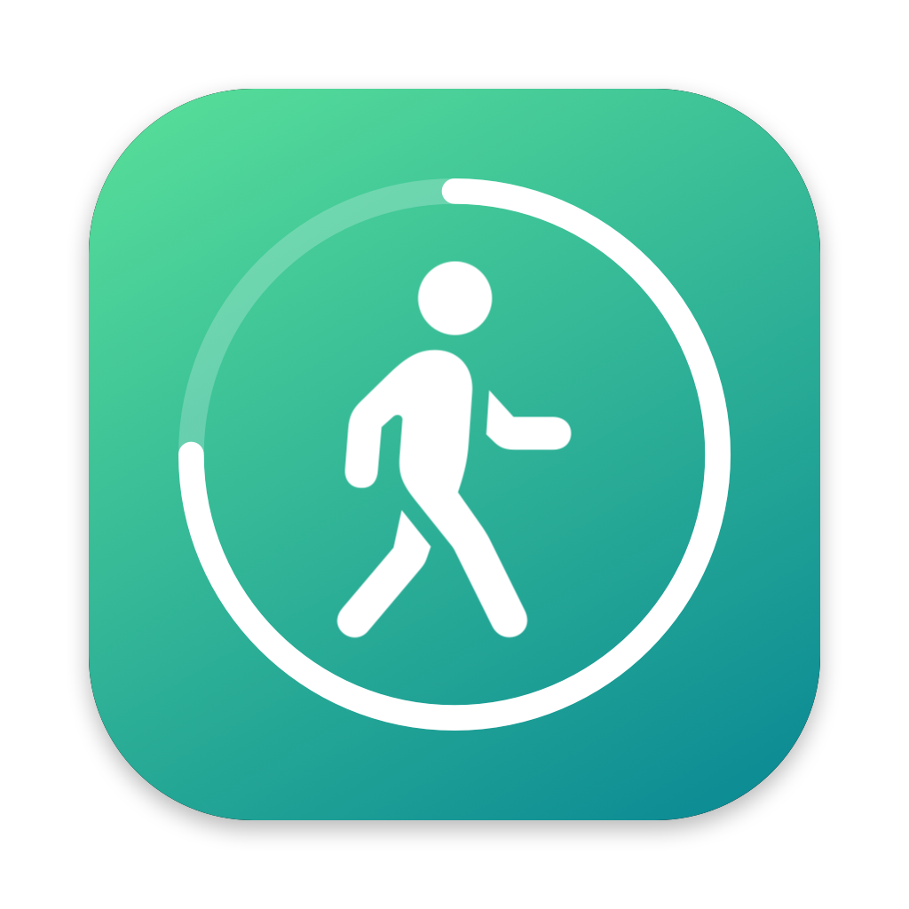

# Move

A tiny macOS menu bar timer that reminds you to stand up and move.

Every 90 minutes (or whatever you choose) Move plays a short sound and shows a notification. Ten minutes before, it sends a heads up so you can wrap up what you're doing.

## Features

- Lives in the menu bar with a live countdown. No Dock icon, no windows.
- Warning notification before each break ("Move in 10 min").
- Five alarm sounds: Ding, Beep, Tink, Chime, Sonar. Preview each one.
- Ring 1, 2 or 3 times, with adjustable volume.
- Click the countdown to set the time left (`0:19`, `19`, `19m`, `1h5m`).
- Pause, reset, or move now.
- If your Mac sleeps past a break, the timer starts fresh instead of ringing late.
- Launch at login.
- One Swift file, no dependencies.

## Requirements

- macOS 14 or later, Apple silicon
- Xcode or the Xcode Command Line Tools (`xcode-select --install`)

## Install

```bash
git clone https://github.com/richkapp/move.git
cd move
./build.sh
```

This builds `Move.app`, installs it to `~/Applications` and launches it. Allow notifications when macOS asks, otherwise you won't see the warning.

## Settings

Click the walking figure in the menu bar:

| Setting | Default |
| --- | --- |
| Interval | 90 min (5 to 240) |
| Warning | 10 min before (0 turns it off) |
| Sound | Ding |
| Rings | 2× |
| Countdown in menu bar | On |
| Launch at login | Off |

Settings are saved between launches.

## Files

- `Move.swift`: the whole app
- `make-icon.swift`: draws the app icon
- `build.sh`: builds, signs (ad hoc) and installs

## License

MIT
